# Hey, I'm Emmanuel (Manny) Onotota

*on-oh-tow-tah*

I'm a Computer Science student interested in backend engineering,
distributed systems, and cloud infrastructure.

I primarily build with Java and Spring Boot. I enjoy understanding
how things work and turning ideas into usable software.

## Tech Stack

**Languages:** Java, TypeScript, JavaScript, SQL, C++

**Frameworks:** Spring Boot, React, Hibernate

**Tools & Infrastructure:** Docker, AWS, Git, MySQL, PostgreSQL

## What I'm Working On
- Creating my own Shell
- Exploring backend development and system design.

## Beyond Code

- Former Xfinity Retail Sales Consultant — top 10% company-wide.
- Former Student Government Association President.
- NASA Lunabotics software team contributor.

## GitHub Stats

  
  

---

[LinkedIn](https://linkedin.com/in/emmanuelonotota) •
[Portfolio](https://mannyonotota.dev)
